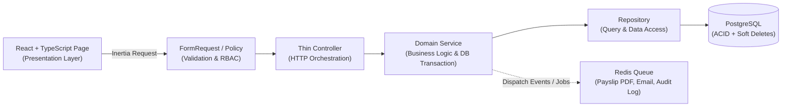

# HRIS Technical Blueprint & Architecture

Dokumen ini mendefinisikan pilihan *tech stack*, arsitektur sistem, dan struktur direktori modular untuk pengembangan aplikasi HRIS.

---

## 1. Rekomendasi Tech Stack Utama

Arsitektur yang dipilih adalah **Modular Monolith** berbasis ekosistem modern yang produktif, aman, dan *type-safe*:

| Layer | Teknologi Utama | Peran dalam HRIS |
| :--- | :--- | :--- |
| **Backend Framework** | **Laravel 12 (PHP 8.3+)** | Pondasi bisnis utama, routing, validasi, queue worker, task scheduling, dan keamanan. |
| **Frontend Bridge** | **Inertia.js v2** | Menghubungkan Laravel dengan SPA React tanpa kompleksitas duplikasi REST/GraphQL API internal. |
| **Frontend UI** | **React 19 + TypeScript + Tailwind CSS + shadcn/ui** | Antarmuka pengguna reaktif, tabel data padat, form kompleks, dan *type-safety* di sisi klien. |
| **Database Utama** | **PostgreSQL 16+** | Penyimpanan relasional dengan kepatuhan ACID ketat, tipe `NUMERIC/DECIMAL` presisi tinggi, dan performa laporan analitik. |
| **Cache & Queue** | **Redis** | Antrean proses latar belakang (*bulk payslip PDF generation*, rekap absensi bulanan, pengiriman email) & *session/cache*. |
| **Auth & RBAC** | **Session-based Auth + Spatie Laravel Permission** | Otentikasi aman bebas celah penyimpanan token di `localStorage`, dilengkapi manajemen Role & Permission granular. |
| **Testing** | **Pest PHP + Vitest / Playwright** | Pengujian Unit, Feature/Integration backend, dan komponen/alur kritikal frontend. |

---

## 2. Alasan Pemilihan Stack untuk Sistem HRIS

1. **Transaksi Finansial & Akurasi Data Tinggi (PostgreSQL + Laravel DB Transactions)**:
   Sistem HRIS menangani perhitungan gaji, potongan, dan saldo cuti yang tidak boleh mengalami *race condition* atau inkonsistensi. Laravel + PostgreSQL memiliki dukungan *row-level locking* (`SELECT ... FOR UPDATE`), transaksi ACID, dan presisi angka desimal (`BCMath` + `NUMERIC`) yang sangat matang.
2. **Kecepatan Development Tanpa Mengorbankan Interaktivitas (Inertia.js + React TypeScript)**:
   Aplikasi HRIS didominasi oleh tabel berfilter kompleks, kalender kehadiran, alur persetujuan (*approval workflow*), dan formulir berlapis. Inertia.js memberikan pengalaman SPA sekelas Next.js/React murni, namun menghilangkan beban pemeliharaan dua repositori terpisah, sinkronisasi token CORS/JWT yang rumit, dan duplikasi state management. Jika di masa depan dibutuhkan aplikasi *mobile* (mis. *clock-in* via HP), layer `Service` yang sudah terpisah dari Controller dapat langsung digunakan kembali oleh `ApiController` (Laravel Sanctum) tanpa menulis ulang logika bisnis.
3. **Ekosistem Matang untuk Kebutuhan Spesifik HR**:
   - **Queue & Batch Jobs**: Pembuatan ribuan slip gaji PDF secara asinkron dengan pemantauan progres.
   - **Scheduler**: Otomatisasi reset kuota cuti tahunan, penandaan *alpha* harian, dan pengingat masa kontrak habis (*PKWT reminder*).
   - **Audit & Security**: Dukungan ekosistem *battle-tested* untuk RBAC, *activity logging*, proteksi CSRF/XSS/SQL Injection, dan enkripsi kolom sensitif (*encrypted casts* untuk NIK/rekening).
4. **Modular Monolith > Premature Microservices**:
   Memisahkan domain ke dalam modul-modul terisolasi di dalam satu kode basis menjaga kemudahan *deployment*, konsistensi transaksi lintas domain (mis. `Attendance` -> `Payroll`), serta memudahkan manusia maupun AI menelusuri alur kode secara menyeluruh.

---

## 3. Alur Arsitektur Sistem



---

## 4. Pola Struktur Folder Modular

Kode diorganisasikan berdasarkan **Domain / Modul Bisnis** (`CoreHR`, `Attendance`, `Payroll`, `RBAC`), bukan sekadar menumpuk ratusan file di satu folder `Controllers` atau `Services` global.

```text
hris/
├── .ai/                              # Dokumentasi konteks & aturan wajib untuk AI/Developer
│   ├── rules.md
│   ├── architecture.md
│   ├── domain-models.md
│   └── roadmap.md
├── app/
│   ├── Shared/                       # Utilitas lintas modul (BaseRepository, AuditableTrait, MoneyHelper)
│   │   ├── Contracts/
│   │   ├── Traits/                   # HasAuditColumns, SoftDeletes konfigurasi standar
│   │   └── Exceptions/
│   └── Modules/                      # Domain-Driven Modular Structure
│       ├── RBAC/                     # Modul Autentikasi, User, Role, Permission, Audit Log
│       │   ├── Controllers/
│       │   ├── Requests/
│       │   ├── Services/
│       │   ├── Repositories/
│       │   ├── Models/
│       │   └── Policies/
│       ├── CoreHR/                   # Modul Organisasi & Data Induk Karyawan (Department, Position, Employee)
│       │   ├── Controllers/
│       │   ├── Requests/
│       │   ├── Services/
│       │   ├── Repositories/
│       │   ├── Models/
│       │   ├── Policies/
│       │   └── Resources/            # Data transformers / DTO untuk frontend
│       ├── Attendance/               # Modul Kehadiran, Jam Kerja, & Pengajuan Cuti (Attendance, LeaveRequest)
│       │   ├── Controllers/
│       │   ├── Requests/
│       │   ├── Services/
│       │   ├── Repositories/
│       │   ├── Models/
│       │   └── Policies/
│       └── Payroll/                  # Modul Komponen Gaji, Proses Penggajian, & Slip Gaji
│           ├── Controllers/
│           ├── Requests/
│           ├── Services/
│           ├── Repositories/
│           ├── Jobs/                 # GeneratePayslipPdfJob, ProcessMonthlyPayrollJob
│           ├── Models/
│           └── Policies/
├── database/
│   ├── migrations/                   # Urutan migrasi skema database terpusat
│   ├── factories/                    # Model factories untuk pengujian otomatis
│   └── seeders/                      # Seeder Role/Permission awal & master data dasar
├── resources/
│   └── js/
│       ├── Components/               # Komponen UI reusable (Button, DataTable, Modal, FormField)
│       ├── Layouts/                  # AuthenticatedLayout, Sidebar berbasis permission RBAC
│       ├── Modules/                  # Halaman & komponen spesifik domain (sejajar dengan backend)
│       │   ├── RBAC/
│       │   ├── CoreHR/
│       │   ├── Attendance/
│       │   └── Payroll/
│       └── Types/                    # Definisi interface TypeScript global & per modul
└── tests/
    ├── Unit/
    │   └── Modules/                  # Unit test Service layer per modul (CoreHR, Attendance, Payroll)
    └── Feature/
        └── Modules/                  # Integration & RBAC test per modul
```

### Aturan Komunikasi Antar-Modul
1. Sebuah modul **tidak boleh** memodifikasi tabel milik modul lain secara langsung melalui *query* tulis.
2. Jika modul `Payroll` membutuhkan rekap kehadiran dan cuti karyawan, `PayrollService` harus memanggil kontrak/antarmuka resmi dari modul `Attendance` (mis. `AttendanceSummaryService`) dan `CoreHR` (`EmployeeRepository`).
3. Seluruh model utama wajib menggunakan trait standar (`SoftDeletes` dan `HasAuditColumns` untuk pengisian otomatis `created_by` dan `updated_by`).

