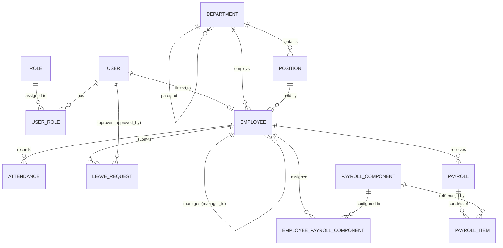

# HRIS Domain Models & Database Schema Blueprint

Dokumen ini memetakan entitas inti sistem HRIS, relasi antar-entitas (ERD), serta atribut kunci yang menjadi acuan pembuatan migrasi database, model, dan validasi.

> **Catatan Standar Tabel**:
> Seluruh tabel entitas bisnis di bawah ini **wajib** menyertakan kolom sistem standar berikut (kecuali tabel pivot murni):
> - `id`: `UUID` atau `BIGINT` Primary Key (konsisten di seluruh tabel; direkomendasikan `UUID v7` atau `BIGINT` dengan UUID publik untuk eksposur URL).
> - `created_at`: `TIMESTAMP`
> - `updated_at`: `TIMESTAMP`
> - `deleted_at`: `TIMESTAMP NULL` (*Soft Deletes*)
> - `created_by`: `FK -> users.id NULL`
> - `updated_by`: `FK -> users.id NULL`

---

## 1. Entity-Relationship Diagram (ERD)

---

## 2. Spesifikasi Entitas & Atribut Kunci

### A. Modul RBAC (`users` & `roles`)

#### 1. `User` (Tabel: `users`)
Representasi akun kredensial untuk masuk ke dalam sistem. Dipisahkan dari `Employee` agar akun sistem (mis. Super Admin IT atau Auditor eksternal) tidak harus tercatat sebagai pegawai aktif di payroll, maupun sebaliknya.
- `id` (PK)
- `name` (`VARCHAR(150)`)
- `email` (`VARCHAR(150)`, Unique)
- `password` (`VARCHAR(255)`)
- `is_active` (`BOOLEAN`, default `true`)
- `last_login_at` (`TIMESTAMP NULL`)
- *Audit & Soft Delete columns*

#### 2. `Role` (Tabel: `roles` + `permissions` & pivot `model_has_roles`, `role_has_permissions`)
Mengatur hak akses pengguna secara terstruktur (contoh Role bawaan: `super_admin`, `hr_admin`, `finance_payroll`, `manager`, `employee`).
- `id` (PK)
- `name` (`VARCHAR(100)`, Unique — contoh: `hr_admin`)
- `display_name` (`VARCHAR(150)` — contoh: `HR Administrator`)
- `guard_name` (`VARCHAR(50)`, default `web`)
- `description` (`TEXT NULL`)
- *Timestamps*

---

### B. Modul Core HR (`departments`, `positions`, `employees`)

#### 3. `Department` (Tabel: `departments`)
Unit organisasi atau divisi perusahaan, mendukung struktur hierarki bertingkat.
- `id` (PK)
- `code` (`VARCHAR(30)`, Unique — contoh: `DEPT-ENG`)
- `name` (`VARCHAR(150)`)
- `parent_id` (`FK -> departments.id NULL`, untuk sub-departemen)
- `manager_employee_id` (`FK -> employees.id NULL`, kepala departemen)
- `is_active` (`BOOLEAN`, default `true`)
- *Audit & Soft Delete columns*

#### 4. `Position` (Tabel: `positions`)
Jabatan struktural/fungsional beserta level/grade di dalam organisasi.
- `id` (PK)
- `code` (`VARCHAR(30)`, Unique — contoh: `POS-SWE-SR`)
- `title` (`VARCHAR(150)` — contoh: `Senior Software Engineer`)
- `department_id` (`FK -> departments.id`)
- `level` (`VARCHAR(50)` — contoh: `Staff`, `Supervisor`, `Manager`, `Director`)
- `base_salary_min` (`DECIMAL(15, 2) NULL` — batas bawah referensi grade)
- `base_salary_max` (`DECIMAL(15, 2) NULL` — batas atas referensi grade)
- `is_active` (`BOOLEAN`, default `true`)
- *Audit & Soft Delete columns*

#### 5. `Employee` (Tabel: `employees`)
Data induk kepegawaian, kontrak kerja, informasi personal, dan parameter dasar finansial karyawan.
- `id` (PK)
- `user_id` (`FK -> users.id NULL`, Unique — relasi 1-to-1 opsional ke akun login)
- `employee_code` (`VARCHAR(30)`, Unique — NIP/NIK Perusahaan, mis. `EMP-2026-0001`)
- `full_name` (`VARCHAR(150)`)
- `national_id_number` (`TEXT NULL` — NIK KTP, dienkripsi di level aplikasi)
- `tax_id_number` (`TEXT NULL` — NPWP, dienkripsi di level aplikasi)
- `gender` (`ENUM: MALE, FEMALE`)
- `birth_date` (`DATE NULL`)
- `phone_number` (`VARCHAR(30) NULL`)
- `personal_email` (`VARCHAR(150) NULL`)
- `address` (`TEXT NULL`)
- `department_id` (`FK -> departments.id`)
- `position_id` (`FK -> positions.id`)
- `manager_id` (`FK -> employees.id NULL` — atasan langsung untuk alur *approval*)
- `employment_type` (`ENUM: PERMANENT, CONTRACT, PROBATION, INTERN`)
- `employment_status` (`ENUM: ACTIVE, ON_LEAVE, RESIGNED, TERMINATED`)
- `hire_date` (`DATE`)
- `end_date` (`DATE NULL` — akhir kontrak atau tanggal efektif *resign*)
- `basic_salary` (`DECIMAL(15, 2)` — gaji pokok bulanan)
- `bank_name` (`VARCHAR(100) NULL`)
- `bank_account_number` (`TEXT NULL` — dienkripsi di level aplikasi)
- `bank_account_holder` (`VARCHAR(150) NULL`)
- *Audit & Soft Delete columns*

---

### C. Modul Attendance & Leave (`attendances`, `leave_requests`)

#### 6. `Attendance` (Tabel: `attendances`)
Catatan kehadiran harian karyawan (*clock-in* & *clock-out*). Kombinasi `(employee_id, attendance_date)` bersifat unik untuk rekaman aktif.
- `id` (PK)
- `employee_id` (`FK -> employees.id`)
- `attendance_date` (`DATE`)
- `clock_in_at` (`TIMESTAMP NULL`)
- `clock_out_at` (`TIMESTAMP NULL`)
- `status` (`ENUM: PRESENT, LATE, HALF_DAY, ABSENT, ON_LEAVE, HOLIDAY`)
- `late_minutes` (`INTEGER`, default `0`)
- `overtime_minutes` (`INTEGER`, default `0`)
- `work_minutes` (`INTEGER`, default `0`)
- `clock_in_location` (`JSONB NULL` — koordinat/IP opsional)
- `clock_out_location` (`JSONB NULL`)
- `notes` (`TEXT NULL`)
- *Audit & Soft Delete columns*

#### 7. `LeaveRequest` (Tabel: `leave_requests`)
Transaksi pengajuan cuti atau izin karyawan beserta status persetujuannya.
- `id` (PK)
- `employee_id` (`FK -> employees.id`)
- `leave_type` (`ENUM: ANNUAL, SICK, MATERNITY, PATERNITY, UNPAID, MARRIAGE, COMPASSIONATE`)
- `start_date` (`DATE`)
- `end_date` (`DATE`)
- `total_days` (`DECIMAL(4, 1)` — mendukung cuti setengah hari mis. `0.5` atau penuh `3.0`)
- `reason` (`TEXT`)
- `attachment_path` (`VARCHAR(255) NULL` — mis. surat keterangan dokter)
- `status` (`ENUM: PENDING, APPROVED, REJECTED, CANCELLED`, default `PENDING`)
- `approved_by` (`FK -> users.id NULL`)
- `approved_at` (`TIMESTAMP NULL`)
- `rejection_reason` (`TEXT NULL`)
- *Audit & Soft Delete columns*

*(Catatan: Kuota saldo cuti tahunan per periode dapat dikelola melalui tabel pendamping `leave_balances` dengan atribut `employee_id`, `year`, `quota_days`, `used_days`, `remaining_days`).*

---

### D. Modul Payroll (`payroll_components`, `payrolls`, & rinciannya)

#### 8. `PayrollComponent` (Tabel: `payroll_components`)
Master komponen pendapatan (*Allowance/Earning*) dan potongan (*Deduction*) yang dapat digunakan pada penggajian.
- `id` (PK)
- `code` (`VARCHAR(50)`, Unique — contoh: `ALW_TRANSPORT`, `DED_BPJS_KES`, `DED_LATE`)
- `name` (`VARCHAR(150)` — contoh: `Tunjangan Transportasi`)
- `type` (`ENUM: EARNING, DEDUCTION`)
- `calculation_type` (`ENUM: FIXED, DAILY_ATTENDANCE, PERCENTAGE_OF_BASIC, MANUAL`)
- `default_amount` (`DECIMAL(15, 2)`, default `0.00`)
- `is_taxable` (`BOOLEAN`, default `true`)
- `is_active` (`BOOLEAN`, default `true`)
- *Audit & Soft Delete columns*

*(Relasi penugasan komponen rutin per karyawan disimpan di pivot `employee_payroll_components`: `employee_id`, `payroll_component_id`, `custom_amount`, `effective_date`).*

#### 9. `Payroll` (Tabel: `payrolls`)
Rekaman induk slip gaji seorang karyawan pada satu periode penggajian tertentu. Kombinasi `(employee_id, period_year, period_month)` bersifat unik untuk status aktif.
- `id` (PK)
- `payroll_number` (`VARCHAR(50)`, Unique — contoh: `PAY-202610-0001`)
- `employee_id` (`FK -> employees.id`)
- `period_year` (`SMALLINT` — contoh: `2026`)
- `period_month` (`SMALLINT` — `1` s/d `12`)
- `period_start_date` (`DATE`)
- `period_end_date` (`DATE`)
- `attendance_days` (`SMALLINT`, default `0` — snapshot hari hadir)
- `unpaid_leave_days` (`DECIMAL(4, 1)`, default `0` — snapshot cuti tak berbayar)
- `basic_salary` (`DECIMAL(15, 2)` — snapshot gaji pokok saat periode digenerate)
- `total_earnings` (`DECIMAL(15, 2)` — total tunjangan tambahan di luar gaji pokok)
- `total_deductions` (`DECIMAL(15, 2)` — total seluruh potongan & pajak)
- `net_salary` (`DECIMAL(15, 2)` — *Take Home Pay*: `basic_salary + total_earnings - total_deductions`)
- `status` (`ENUM: DRAFT, APPROVED, PUBLISHED, PAID, VOID`, default `DRAFT`)
- `approved_by` (`FK -> users.id NULL`)
- `approved_at` (`TIMESTAMP NULL`)
- `paid_at` (`TIMESTAMP NULL`)
- `employee_snapshot` (`JSONB` — menyimpan snapshot nama departemen, jabatan, dan rekening saat slip diterbitkan agar histori tidak berubah jika karyawan mutasi di masa depan)
- *Audit & Soft Delete columns*

#### 10. Rincian Baris Slip: `PayrollItem` (Tabel: `payroll_items`)
Menghubungkan `Payroll` dengan `PayrollComponent` sehingga setiap rincian angka pada slip gaji tersimpan secara permanen (*immutable snapshot*).
- `id` (PK)
- `payroll_id` (`FK -> payrolls.id`)
- `payroll_component_id` (`FK -> payroll_components.id NULL`)
- `component_code` (`VARCHAR(50)` — snapshot kode komponen)
- `component_name` (`VARCHAR(150)` — snapshot nama komponen)
- `type` (`ENUM: EARNING, DEDUCTION`)
- `amount` (`DECIMAL(15, 2)`)
- `notes` (`VARCHAR(255) NULL` — mis. keterangan jumlah hari hadir atau menit terlambat)
- *Timestamps*

---

## 3. Ringkasan Relasi Kunci

1. **`User` 1 — 0..1 `Employee`**: Satu `User` bisa terhubung ke tepat satu profil `Employee` (untuk Employee Self-Service), sementara tidak semua akun sistem harus memiliki profil karyawan.
2. **`Department` 1 — N `Position` & `Employee`**: Satu departemen menaungi banyak posisi jabatan dan banyak karyawan, serta mendukung *self-referencing* `parent_id` untuk struktur organisasi bercabang.
3. **`Employee` 1 — N `Employee` (`manager_id`)**: Relasi atasan-bawahan langsung untuk menentukan siapa yang berhak menyetujui `LeaveRequest` atau memantau `Attendance` tim.
4. **`Employee` 1 — N `Attendance` & `LeaveRequest`**: Setiap karyawan memiliki histori kehadiran harian dan riwayat pengajuan cuti yang tidak boleh dihapus permanen.
5. **`Employee` 1 — N `Payroll` 1 — N `PayrollItem` N — 1 `PayrollComponent`**: Master `PayrollComponent` mendefinisikan aturan komponen, lalu setiap bulan sistem men-generate `Payroll` per karyawan beserta rincian baris `PayrollItem` sebagai *snapshot* finansial yang tetap.

